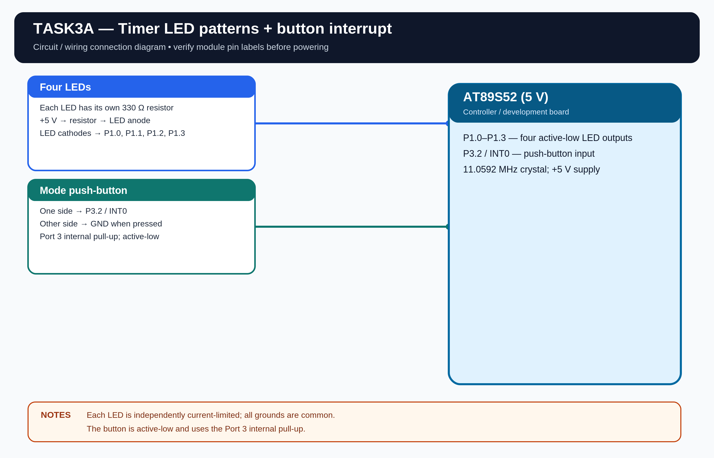

# EXPERIMENT DETAILS

**EXP:** CONTINUOUS ASSESSMENT 3

**DATE:** 27/07/2026

**REGISTRATION NUMBER:** `25011102002`

**TASK NO:** `TASK3A`

**NAME OF EXP:** Timer-Based LED Pattern Generator and Button Interrupt Controller

**HARDWARE SETUP / PLATFORM:** AT89S52 Microcontroller + Keil µVision

---

## TASK 3A : Timer-Based LED Pattern Generator and Button Interrupt Controller

### 1. Hardware Setup

Four LEDs provide the visual output, while a push-button supplies the user input that selects the operating mode.

- **Microcontroller:** AT89S52
- **CPU Core:** 8-bit 8051
- **LED GPIO Port:** Port 1
- **LED GPIO Pins:** P1.0, P1.1, P1.2 and P1.3
- **Button Pin:** P3.2 / INT0
- **Peripheral:** Four external LEDs and one push-button
- **Power Supply:** 5V DC
- **LED Active State:** LOW
- **Crystal Frequency:** 11.0592 MHz
- **Timer:** Timer 0, 10 ms tick
- **Button Debounce:** 20 ms

The four active-low LEDs are assigned to P1.0-P1.3, each with a 330 Ω series resistor. The push-button is wired to P3.2/INT0 and pulls the input to GND when pressed; the Port 3 internal pull-up is used. The system clock is 11.0592 MHz.

### 2. Circuit Diagram

### 3. Core Logic / Pseudocode / Code Base

**Working Principle:**

Port 1 drives the four LED outputs, and the push-button is serviced through external interrupt INT0. A debounced press advances the controller to the next display mode.

Timer 0 generates a 10 ms tick, which is used for LED timing and button debouncing. A 20 ms debounce check ensures that one physical press produces only one mode change.

**Operating Modes:**

- **Mode 1 — Running LED:** LEDs turn ON one by one from LED1 to LED4 and repeat.
- **Mode 2 — Binary Counter:** LEDs display the binary count from 0000 to 1111 and repeat.
- **Mode 3 — Alternating Pattern:** LEDs alternate between 1010 and 0101.
- **Mode 4 — All LED Flash:** All LEDs turn ON and OFF together.

The system starts with all LEDs OFF. Each valid button press advances to the next mode. After Mode 4, the next press returns to Mode 1.

**Pseudocode:**

1. Configure four LED pins as outputs and the button on INT0 as input.
2. Configure Timer 0 to generate a 10 ms tick.
3. Enable the external button interrupt.
4. Keep all LEDs OFF initially.
5. Detect a button press using INT0.
6. Debounce the button and confirm the press.
7. Advance to the next LED operating mode.
8. Update the LED pattern every 500 ms using the timer tick.
9. Repeat continuously.

**Code Base:**

The program is written in Embedded C using Keil C51.

- `REGX51.H` provides the 8051 register definitions.
- `P1.0-P1.3` control the four LEDs.
- `P3.2 / INT0` is used for the push-button interrupt.
- `timer0_isr()` generates the 10 ms timer tick.
- `external0_isr()` detects the button press.
- `set_led_pattern()` controls the LED outputs.
- `update_mode()` generates the four LED patterns.
- A 20 ms debounce check prevents repeated mode changes from one button press.

### 4. Inference

A confirmed button press selects the next of the four LED patterns. Timer 0 provides the timing reference and INT0 detects the user input.

The experiment demonstrates direct GPIO register access, timer interrupt programming, external interrupt handling and switch debouncing using bare-metal Embedded C.
