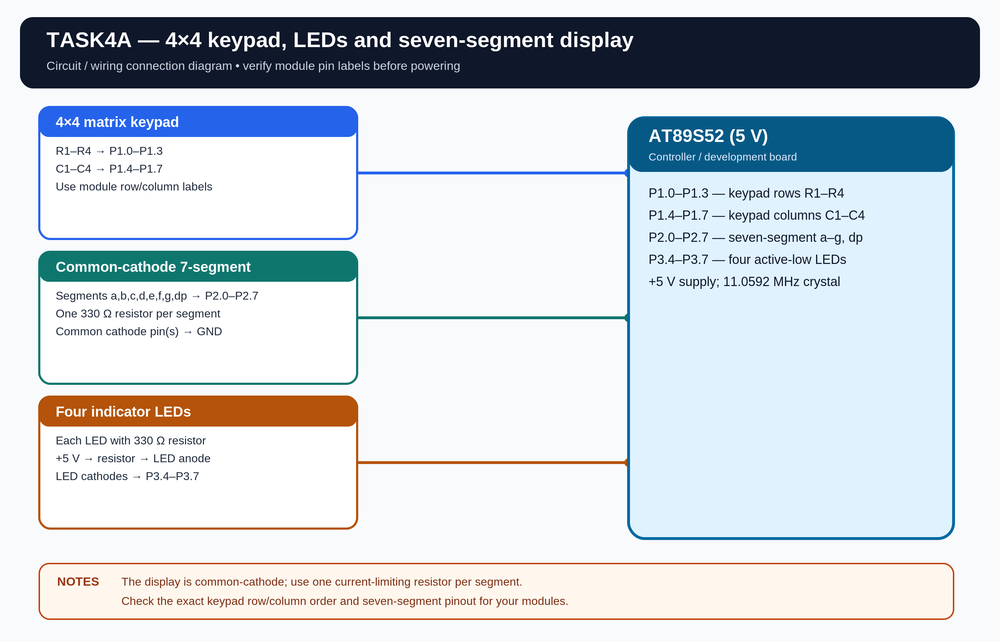

# EXPERIMENT DETAILS

**EXP:** CONTINUOUS ASSESSMENT 4

**DATE:** 03/08/2026

**REGISTRATION NUMBER:** `25011102002`

**TASK NO:** `TASK4A`

**NAME OF EXP:** Human-Machine Interface using Matrix Keypad, LEDs, and Seven-Segment Display

**HARDWARE SETUP / PLATFORM:** AT89S52 Microcontroller + Keil µVision

---

## TASK 4A : Keypad-Based LED and Seven-Segment Controller

### 1. Hardware Setup

A 4x4 keypad is used to select an operation, the seven-segment display reports the key value, and four LEDs show the resulting mode.

- **Microcontroller:** AT89S52
- **CPU Core:** 8-bit 8051
- **Keypad:** 4x4 matrix keypad
- **Keypad Rows:** P1.0-P1.3
- **Keypad Columns:** P1.4-P1.7
- **Seven-Segment Display:** Common-cathode, connected to Port 2
- **LED GPIO Pins:** P3.4-P3.7 (LED1=P3.4, LED2=P3.5, LED3=P3.6, LED4=P3.7)
- **Peripheral:** Four LEDs, matrix keypad and one seven-segment display
- **Power Supply:** 5V DC
- **LED Active State:** LOW
- **Crystal Frequency:** 11.0592 MHz
- **Keypad Debounce:** Approximately 20 ms

The design uses a standard 4x4 keypad and a common-cathode seven-segment display. Port 1 is assigned to the keypad, Port 2 to the display and P3.4-P3.7 to the LEDs. Individual 330 Ω resistors limit LED/segment current, and the crystal frequency is 11.0592 MHz.

### 2. Circuit Diagram

### 3. Core Logic / Pseudocode / Code Base

**Working Principle:**

The firmware scans the keypad matrix, decodes the pressed key and displays that value on the seven-segment unit before carrying out the associated LED action.

**LED Operations:**

- **Key 1-4:** Turn ON the corresponding LED.
- **Key 5:** Run the LEDs one by one in sequence.
- **Key 6:** Alternate the LED pattern between 1010 and 0101.
- **Key 7:** Display a binary count from 0 to 15 using the four LEDs.
- **Key 8:** Blink all four LEDs together.
- **Key 9:** Turn all LEDs OFF.
- **Key 0:** Reset the LED operation and turn all LEDs OFF.

**Pseudocode:**

1. Configure the keypad, LEDs and seven-segment display.
2. Scan the matrix keypad for a valid key press.
3. Display the pressed key on the seven-segment display.
4. Execute the corresponding LED operation.
5. Continue scanning for the next key press.
6. Repeat continuously.

**Code Base:**

The program is written in Embedded C using Keil C51.

- `REGX51.H` provides the 8051 register definitions.
- `keypad_scan()` scans the matrix keypad.
- `display_digit()` displays the pressed key.
- `led_control()` selects the LED operation.
- `running_led()` generates the running LED pattern.
- `binary_counter()` generates the binary count from 0 to 15.
- `alternate_led()` alternates between 1010 and 0101.
- `blink_all()` blinks all four LEDs together.
- `Objects/TASK4A.hex` contains the compiled firmware.

### 4. Inference

The displayed digit identifies the key that was detected, while the LED outputs reflect the operation mapped to that key.

The experiment demonstrates matrix keypad scanning, GPIO control, seven-segment display interfacing and basic embedded C programming using the AT89S52.
