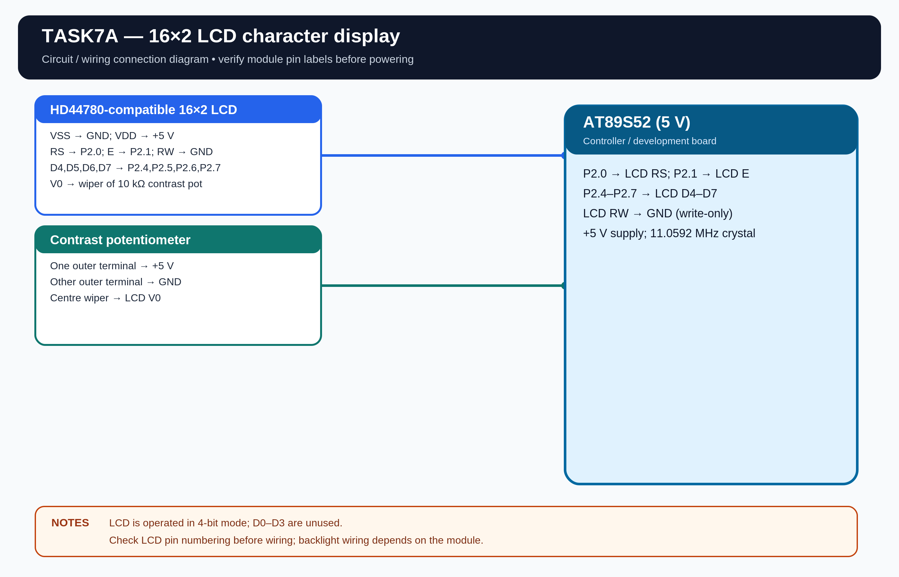

# EXPERIMENT DETAILS

**EXP:** CONTINUOUS ASSESSMENT 7

**DATE:** 24/08/2026

**REGISTRATION NUMBER:** `25011102002`

**TASK NO:** `TASK7A`

**NAME OF EXP:** 16x2 LCD Driver Development and Dynamic Display Control

**HARDWARE SETUP / PLATFORM:** AT89S52 Microcontroller + Keil µVision

---

## TASK 7A : LCD Initialization and Character/String Display

### 1. Hardware Setup

An HD44780-compatible 16x2 LCD is interfaced with the AT89S52 through four data lines in 4-bit mode.

- **Microcontroller:** AT89S52
- **LCD:** 16x2 HD44780-compatible
- **Interface:** 4-bit mode
- **LCD RS:** P2.0
- **LCD E:** P2.1
- **LCD D4-D7:** P2.4-P2.7
- **LCD RW:** GND
- **Power Supply:** 5V DC
- **Contrast:** 10 kΩ potentiometer at V0
- **Crystal Frequency:** 11.0592 MHz

The LCD control signals RS and E are connected to P2.0 and P2.1, while D4-D7 use P2.4-P2.7. RW is tied to GND; the display is powered from 5V and its contrast is adjusted with a potentiometer.

### 2. Circuit Diagram

### 3. Core Logic / Pseudocode / Code Base

**Working Principle:**

Initialization commands place the LCD in 4-bit, two-line mode and configure cursor/display behavior. The firmware then writes the character 'A' at the start of row one and a text string on row two.

**Pseudocode:**

1. Configure the LCD GPIO pins.
2. Initialize the LCD in 4-bit, 2-line mode.
3. Set the display ON and cursor OFF.
4. Move the cursor to the first position.
5. Display the character 'A'.
6. Move to the second row and display a string.

**Firmware Output:**

The compiled HEX file is saved at `Objects/TASK7A.hex`.

**Code Base:**

The program is written in Embedded C using Keil C51.

- `lcd_init()` initializes the LCD.
- `lcd_cmd()` sends commands to the LCD.
- `lcd_data()` sends character data.
- `lcd_goto()` positions the cursor.
- `lcd_puts()` displays a string.

### 4. Inference

The expected display contains 'A' on the first line and the selected text on the second. This verifies the LCD startup sequence, command interface and character-data transfer.
