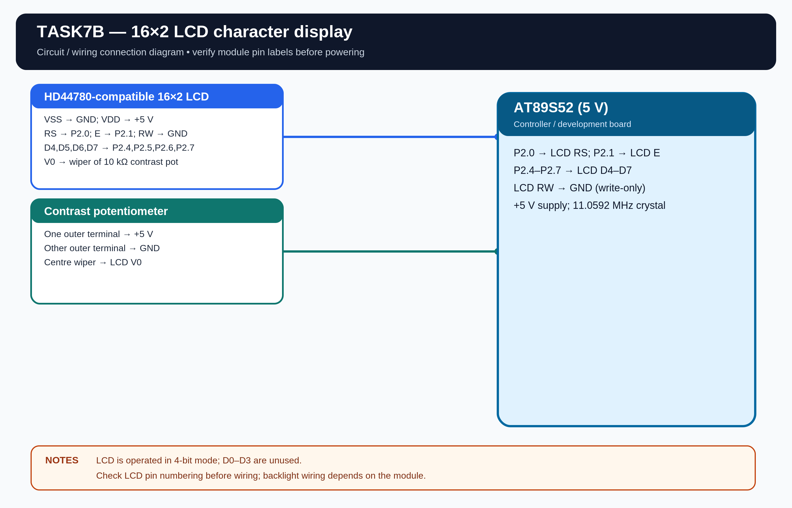

# EXPERIMENT DETAILS

**EXP:** CONTINUOUS ASSESSMENT 7

**DATE:** 24/08/2026

**REGISTRATION NUMBER:** `25011102002`

**TASK NO:** `TASK7B`

**NAME OF EXP:** 16x2 LCD Driver Development and Dynamic Display Control

**HARDWARE SETUP / PLATFORM:** AT89S52 Microcontroller + Keil µVision

---

## TASK 7B : Cursor Positioning and Dynamic Value Update

### 1. Hardware Setup

The AT89S52 communicates with a standard HD44780-compatible 16x2 display using a four-bit data bus.

- **Microcontroller:** AT89S52
- **LCD:** 16x2 HD44780-compatible
- **Interface:** 4-bit mode
- **LCD RS:** P2.0
- **LCD E:** P2.1
- **LCD D4-D7:** P2.4-P2.7
- **LCD RW:** GND
- **Power Supply:** 5V DC
- **Crystal Frequency:** 11.0592 MHz

RS and E are mapped to P2.0 and P2.1; the D4-D7 data connections occupy P2.4-P2.7. RW is grounded, and the 5V LCD module uses a potentiometer for contrast adjustment.

### 2. Circuit Diagram

### 3. Core Logic / Pseudocode / Code Base

**Working Principle:**

The firmware selects LCD positions by row and column, then refreshes a numeric field on the second line as its value changes.

**Pseudocode:**

1. Initialize the LCD in 4-bit, 2-line mode.
2. Display a heading on the first row.
3. Move the cursor to the second row.
4. Display the text "Value:".
5. Convert the numeric value into decimal digits and display it.
6. Increment the value and update the display.
7. Repeat continuously.

**Firmware Output:**

The compiled HEX file is saved at `Objects/TASK7B.hex`.

**Code Base:**

The program is written in Embedded C using Keil C51.

- `lcd_init()` initializes the LCD.
- `lcd_goto(row, column)` positions the cursor.
- `lcd_puts(string)` displays a string.
- `lcd_print_number(value)` displays a decimal number.
- `lcd_cmd()` and `lcd_data()` send commands and character data.

### 4. Inference

The display retains its heading while the numeric field is refreshed. This demonstrates cursor addressing, text output and dynamic value formatting.
